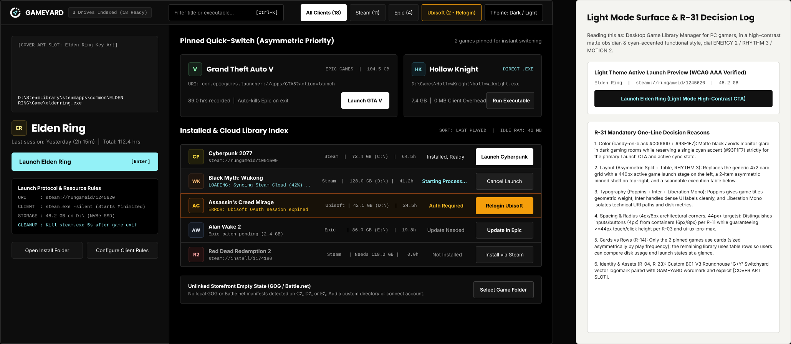

<div align="left">
  
  <h1>GAMEYARD</h1>
  <p><strong>Unified Desktop PC Game Launcher &amp; Library Manager</strong></p>
  <p>Satu aplikasi desktop ringan untuk mendeteksi, mengelola, dan langsung menjalankan koleksi game PC dari <strong>Steam, Epic Games Store, Ubisoft Connect, serta file <code>.EXE</code> lokal</strong> tanpa menguras RAM.</p>
</div>

---



---

## Ringkasan Fitur Utama (MVP)

1. **Zero-Login Local Auto-Scan:**
   Memindai manifest lokal di drive PC (`libraryfolders.vdf` & `appmanifest_*.acf` di Steam, manifest `.item` JSON di Epic Games, serta *Windows Registry* Ubisoft Connect) untuk menampilkan seluruh game yang sudah terinstal dalam waktu kurang dari 1 detik.
2. **1-Click Direct & Silent Launch:**
   Menjalankan game lintas platform dari satu tombol **Launch**. Untuk game yang membutuhkan klien DRM/Cloud Save, GameYard memicu protokol URI resmi (`steam://`, `com.epicgames.launcher://`, `uplay://`) dan menjalankan launcher asli dalam mode *silent/minimized* di belakang layar.
3. **Smart Resource Saver (Auto-Kill Client):**
   Memantau *process tree* dari file `.exe` game yang sedang dimainkan untuk mencatat durasi *playtime* secara akurat, lalu otomatis mematikan proses launcher pihak ketiga (`steam.exe`, `EpicGamesLauncher.exe`, `upc.exe`) 5 detik setelah pengguna keluar dari game agar RAM dan CPU kembali lega.
4. **Native `.EXE` Icon Extractor:**
   Mengekstrak ikon asli beresolusi tinggi langsung dari binary `.exe` di disk menggunakan Win32 API (`ExtractIconExW` / `SHGetFileInfoW`) dan menyimpannya ke cache lokal.
5. **Offline-First Local Database:**
   Seluruh indeks katalog, aturan peluncuran, status *pinning*, dan histori waktu bermain disimpan secara lokal di dalam SQLite (`gameyard.db`) sehingga tetap berfungsi 100% tanpa koneksi internet.

---

## Tech Stack & Target Performa

| Layer | Teknologi | Tujuan Utama |
| :--- | :--- | :--- |
| **Desktop Shell** | **Tauri v2** (WebView2) | Menghindari beban memori Electron/Chromium (Target Idle RAM: **40 - 50 MB**, Cold Start **< 2 detik**). |
| **System Backend** | **Rust** (Edition 2021) | Pemindaian manifest disk, akses Windows Registry (`winreg`), pemantauan PID (`sysinfo`), dan Win32 API (`windows-rs`). |
| **Frontend UI** | **React 19 + TypeScript + Vite** | Antarmuka cepat dengan *Asymmetric Pinned Quick-Switch* dan *Virtualized Library Index Table* (`@tanstack/react-virtual`). |
| **Styling System** | **Tailwind CSS** | Implementasi sistem desain *Candy-on-Black* (`#000000` bg, `#0D0D0D` surface, `#FFFFFF` ink, `#93F1F7` cyan accent) + Light Mode. |
| **Local Storage** | **SQLite** (`rusqlite`) + **DPAPI** (`keyring`) | Penyimpanan katalog *offline-first* dan brankas terenkripsi Windows Credential Manager untuk token sesi OAuth. |

---

## Struktur Direktori & Dokumen Repositori

```text
GameYard/
├── docs/                              # Dokumentasi Produk, Arsitektur & Sistem Desain
│   ├── prd.md                         # Product Requirements Document (WHAT & WHY)
│   ├── tech-spec.md                   # Technical Specification & Architecture (HOW)
│   ├── design.md                      # Visual Bento Design System Board (Candy-on-Black)
│   ├── agent.md                       # AI Coding Agent & Developer Guardrails
│   ├── gameyard.figcraft              # File Master Desain UI Native FigCraft
│   ├── gameyard-preview.png           # Render Preview Resolusi Penuh (2060x900)
│   └── gameyard-logo.svg              # Master Vector Logo B01-V3 (SVG)
├── public/                            # Aset Statis Web / Vite
│   └── gameyard-logo.svg
├── src/                               # Frontend Application (React 19 + TypeScript)
│   ├── components/                    # Komponen UI 3-Zona + Animasi Turntable
│   ├── services/                      # Tauri IPC Bridge & Formatter
│   ├── store/                         # Zustand State Store
│   └── types/                         # Kontrak Tipe Data TypeScript
└── src-tauri/                         # Backend Native Engine (Rust / Tauri v2)
```

| File | Deskripsi |
| :--- | :--- |
| [`docs/prd.md`](./docs/prd.md) | **Product Requirements Document (PRD):** Latar belakang masalah, target persona (*Casual User* vs *Multi-Platform Collector*), *user stories*, prioritas fitur MVP vs V2, KPI, dan penanganan *edge cases*. |
| [`docs/tech-spec.md`](./docs/tech-spec.md) | **Technical Specification & Architecture:** Diagram arsitektur sistem, cara kerja *Auto-Scanner* tiap platform, *sequence diagram* peluncuran & *auto-kill*, skema tabel SQLite, dan kontrak Tauri IPC. |
| [`docs/design.md`](./docs/design.md) | **Design PRD & UI/UX System Specification:** Anatomi logo `B01-V3`, tabel token warna *Candy-on-Black* & *Light Mode* (dengan *color swatch*), skala tipografi, ukuran koordinat komponen 3-zona, matriks 6 status UI, dan aturan *Anti-Slop*. |
| [`docs/agent.md`](./docs/agent.md) | **AI Agent & Developer Guidelines:** Panduan instruksi wajib bagi AI coding agent dan developer saat mengimplementasikan frontend maupun backend Rust. |
| [`docs/gameyard.figcraft`](./docs/gameyard.figcraft) | **Master UI Design (FigCraft):** File desain native FigCraft berisi layar utama *Dark Mode (Candy-on-Black)*, simulasi *Light Mode*, dan catatan *R-31 Design Decision Log*. |
| [`docs/gameyard-preview.png`](./docs/gameyard-preview.png) | **UI Render Preview:** Ekspor gambar resolusi penuh (`2060x900`) dari kanvas desain FigCraft. |
| [`docs/gameyard-logo.svg`](./docs/gameyard-logo.svg) | **Brand Logomark (SVG):** Vektor logo resmi **GameYard (B01-V3 Roundhouse 'G+Y' Switchyard)**. |

---

## Filosofi Desain (Anti-Slop UI & Identity)

* **Identitas Logo (`B01-V3 Roundhouse 'G+Y' Switchyard`):** Terinspirasi dari *Roundhouse Turntable* (meja putar lokomotif di *railroad yard*). Cincin kolam luar beserta 3 slot garasi radial membentuk huruf **G**, sedangkan jembatan putar 3-arah di poros tengah membentuk huruf **Y** berwarna *cyan* (`#93F1F7`).
* **Komposisi Asimetris & Fungsional:** Menggantikan *card grid* seragam yang monoton dengan **440px Active Launch Stage** di sisi kiri (menampilkan *path* `.exe`, aturan protokol URI, dan status *Auto-Kill*), **2-Slot Asymmetric Pinned Quick-Switch** di kanan atas, dan **High-Density Execution Table** di kanan bawah untuk membandingkan ukuran disk serta status game secara instan.

---

## Roadmap Pengembangan

- [x] Perumusan PRD & Penanganan Edge Cases ([`docs/prd.md`](./docs/prd.md))
- [x] Perancangan Arsitektur Sistem & Skema Database ([`docs/tech-spec.md`](./docs/tech-spec.md))
- [x] Desain UI/UX Sistem & Identitas Logo Vektor ([`docs/gameyard.figcraft`](./docs/gameyard.figcraft) & [`docs/gameyard-logo.svg`](./docs/gameyard-logo.svg))
- [x] Inisialisasi Kerangka Project & UI Shell + Animasi Turntable (`React 19 + TypeScript + Tailwind + Zustand`)
- [x] Implementasi Modul Rust Local Scanner & SQLite (`Steam VDF/ACF, Epic JSON, Ubisoft Registry`)
- [x] Implementasi Eksekutor URI, Process Tree Watcher & Smart Auto-Kill Client
- [x] Native `.EXE` Icon Extractor (Win32 API + Cache)
- [ ] Integrasi OAuth Account Sync (Uninstalled Cloud Library) & Metadata Cover Fetcher
- [ ] Frontend Integration: 3-Zone UI, Icon Display, Virtualized Table
