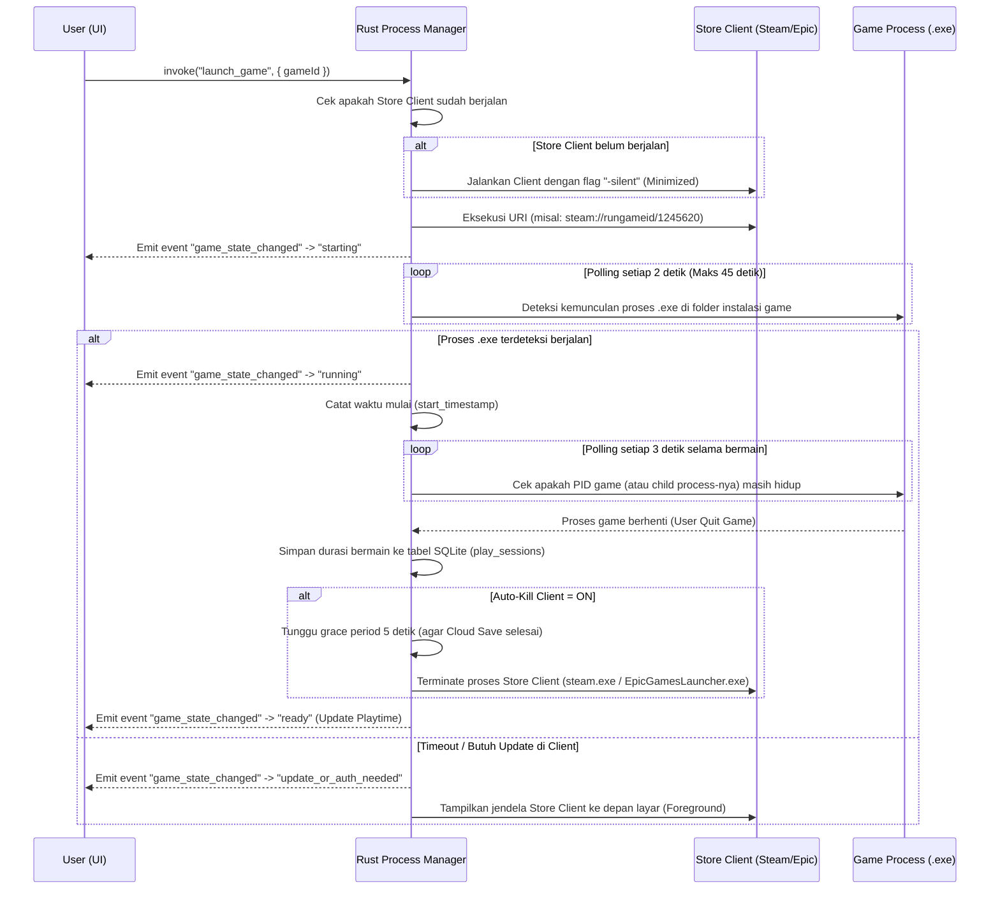

# Technical Specification & Architecture (Tech Spec): GameYard

| Informasi Dokumen | Detail |
| :--- | :--- |
| **Nama Produk** | GameYard (Unified PC Game Launcher & Library Manager) |
| **Dokumen Terkait** | [Product Requirements Document (prd.md)](./prd.md) |
| **Desain UI & Aset** | [gameyard.figcraft](./gameyard.figcraft) & [gameyard-logo.svg](./gameyard-logo.svg) |
| **Target Platform** | Windows 10 / 11 (x64) untuk MVP; arsitektur siap diekspansi ke macOS / Linux |
| **Target Performa** | Idle RAM < 100 MB (Target: ~40-50 MB), Cold Start < 2 detik, Ukuran Installer < 15 MB |

---

## 1. Ringkasan Tech Stack

Untuk menghindari *bloatware* memori seperti aplikasi berbasis Electron/Chromium, **GameYard** dibangun menggunakan arsitektur hibrida ringan **Tauri v2** yang memadukan *native system backend* **Rust** dengan antarmuka **React + TypeScript + Tailwind CSS**.

### 1.1. Layer Utama
* **Desktop Runtime & Shell:** **Tauri v2** (menggunakan *Windows WebView2* bawaan OS untuk merender UI tanpa membundel browser Chromium).
* **System Backend (Core Engine):** **Rust (Edition 2021)** untuk operasi I/O disk, pembacaan *Windows Registry*, ekstraksi ikon `.exe` via Win32 API, pemantauan proses (*process tree*), dan koneksi SQLite.
* **Frontend UI:** **React 19 + TypeScript + Vite**.
* **Styling & Design System:** **Tailwind CSS** dengan CSS Variables kustom untuk palet *Candy-on-Black* (`#000000`, `#0D0D0D`, `#FFFFFF`, `#93F1F7`) dan mode terang (*Light Mode*).
* **Frontend State & List Rendering:**
  * **Zustand:** Menyimpan *active game stage*, filter klien, dan status proses yang sedang berjalan.
  * **TanStack Virtual:** Merender tabel indeks katalog ribuan game pada 60 FPS tanpa membebani DOM.
* **Local Database (Offline-First):** **SQLite** (diakses dari Rust melalui `rusqlite` dengan mode WAL / *Write-Ahead Logging*).

### 1.2. Daftar Crate Rust (Backend Dependencies)
| Crate / Library | Kegunaan Spesifik di GameYard |
| :--- | :--- |
| `tauri` (v2) | Jembatan IPC (*Inter-Process Communication*), manajemen *window*, dan *system tray*. |
| `rusqlite` | Penyimpanan lokal katalog game, aturan *auto-kill*, dan histori sesi bermain (*playtime*). |
| `winreg` | Membaca *Windows Registry* untuk mendeteksi lokasi instalasi Steam, Epic, dan Ubisoft Connect. |
| `keyvalues-parser` / `vdf-rs` | Mem-parsing file konfigurasi Valve (`libraryfolders.vdf` dan `appmanifest_<id>.acf`). |
| `serde` & `serde_json` | Mem-parsing file manifest JSON milik Epic Games (`.item`) dan serialisasi data IPC. |
| `sysinfo` | Memantau daftar proses aktif (PID, nama proses, penggunaan memori) untuk fitur *Playtime Tracking* dan *Auto-Kill Client*. |
| `windows` (`windows-rs`) | Memanggil Win32 API asli (`SHGetFileInfoW`, `ExtractIconExW`, `CreateToolhelp32Snapshot`) untuk mengekstrak ikon `.exe` game dan melacak *parent-child process tree*. |
| `keyring` | Menyimpan token OAuth (Steam/Epic/Ubisoft) secara aman di *Windows Credential Manager (DPAPI)*. |
| `reqwest` + `tokio` | Mengambil metadata tambahan dan *cover art* secara asinkron dari SteamGridDB / IGDB API. |

---

## 2. Arsitektur Sistem

```text
+-----------------------------------------------------------------------------------+
|                        FRONTEND UI (WebView2 / React 19)                          |
|                                                                                   |
|  +-----------------------+   +-------------------------------------------------+  |
|  | Left Launch Stage     |   | Right Library Workspace                         |  |
|  | - Active Game Meta    |   | - Top Command Filter [Ctrl+K] & Storefront Tabs |  |
|  | - Primary Launch CTA  |   | - Asymmetric Pinned Quick-Switch (2 Slots)      |  |
|  | - URI & Cleanup Rules |   | - Virtualized Library Index Table               |  |
|  +-----------------------+   +-------------------------------------------------+  |
+-----------------------------------------+-----------------------------------------+
                                          |
                        Tauri IPC Bridge (Commands & Events)
                                          |
+-----------------------------------------v-----------------------------------------+
|                         BACKEND ENGINE (Native Rust Core)                         |
|                                                                                   |
|  +-----------------------+   +-----------------------+   +---------------------+  |
|  | Manifest Auto-Scanner |   | Launch & Process Mgr  |   | Local Storage & Sec |  |
|  | - Steam VDF/ACF       |   | - URI/CLI Dispatcher  |   | - SQLite (WAL Mode) |  |
|  | - Epic .item JSON     |   | - Silent Client Start |   | - Icon Cache (.png) |  |
|  | - Ubisoft Registry    |   | - Process Tree Watch  |   | - Win DPAPI Keyring |  |
|  | - Win32 Icon Extract  |   | - 5s Grace Auto-Kill  |   | - Cover Art Cache   |  |
|  +-----------------------+   +-----------------------+   +---------------------+  |
+-----------------------------------------------------------------------------------+
```

---

## 3. Mekanisme Deteksi & Sinkronisasi Game (Auto-Scanner)

Salah satu nilai jual utama GameYard (`US-01`) adalah langsung mendeteksi game yang sudah terinstal di PC dalam waktu kurang dari 1 detik tanpa wajib login di awal.

### 3.1. Steam Local Scanner
1. Baca lokasi instalasi Steam dari Registry:
   * `HKCU\Software\Valve\Steam` -> `SteamPath` atau `HKLM\SOFTWARE\WOW6432Node\Valve\Steam` -> `InstallPath`.
2. Baca file `<SteamPath>\steamapps\libraryfolders.vdf` untuk mendapatkan seluruh daftar drive instalasi (misal `C:\`, `D:\SteamLibrary`, `E:\SteamGames`).
3. Pada setiap folder `steamapps`, pindai seluruh file `appmanifest_<appid>.acf`.
4. Ekstrak field:
   * `"appid"` -> ID unik Steam (URI: `steam://rungameid/<appid>`)
   * `"name"` -> Judul game
   * `"installdir"` -> Nama folder di dalam `steamapps\common\<installdir>`
   * `"SizeOnDisk"` -> Ukuran byte di disk (dikonversi ke GB)
5. Cari file `.exe` utama di dalam folder instalasi dan ekstrak ikonnya ke `%APPDATA%\GameYard\cache\icons\steam_<appid>.png`.

### 3.2. Epic Games Store Local Scanner
1. Baca folder manifest publik Epic Games di:
   * `C:\ProgramData\Epic\EpicGamesLauncher\Data\Manifests\*.item` (atau path dari `HKLM\SOFTWARE\WOW6432Node\Epic Games\EpicGamesLauncher` -> `AppDataPath`).
2. Setiap file `.item` berformat JSON. Ekstrak field:
   * `"AppName"` -> ID internal aplikasi Epic
   * `"DisplayName"` -> Judul game
   * `"InstallLocation"` -> Path folder instalasi
   * `"LaunchExecutable"` -> File `.exe` utama
   * `"InstallSize"` -> Ukuran instalasi di disk
3. URI peluncuran yang dibentuk:
   * `com.epicgames.launcher://apps/<AppName>?action=launch&silent=true`

### 3.3. Ubisoft Connect Local Scanner
1. Baca daftar subkey di Registry:
   * `HKLM\SOFTWARE\WOW6432Node\Ubisoft\Launcher\Installs\<uplay_id>`
2. Ambil nilai `InstallDir` dari setiap `<uplay_id>`.
3. Cocokkan nama game dan file `.exe` dari manifest `configuration` lokal Ubisoft Connect atau nama direktori instalasi.
4. URI peluncuran yang dibentuk:
   * `uplay://launch/<uplay_id>/0`

### 3.4. Direct `.EXE` / Custom Game Importer
1. Pengguna memilih file `.exe` atau melakukan *drag-and-drop* shortcut `.lnk`.
2. Jika file `.lnk`, Rust me-resolve target path `.exe` aslinya melalui COM interface `IShellLinkW`.
3. Rust memanggil `ExtractIconExW` / `SHGetFileInfoW` untuk mengekstrak bitmap ikon beresolusi tertinggi (`256x256` atau `48x48`) dari resource `.exe` dan menyimpannya sebagai PNG lokal.

---

## 4. Alur Peluncuran 1-Klik, Process Tree Watcher & Smart Auto-Kill

Fitur ini memastikan pengguna cukup menekan satu tombol **Launch** dan RAM PC kembali lega setelah selesai bermain (`US-03`, `US-05`, dan *Edge Case Double Launcher*).



---

## 5. Skema Database Lokal (SQLite)

File database disimpan di `%APPDATA%\GameYard\gameyard.db`.

```sql
-- Tabel Utama Katalog Game (Installed & Cloud)
CREATE TABLE IF NOT EXISTS games (
    id TEXT PRIMARY KEY,                  -- Format: "steam_1245620", "epic_GTA5", "local_uuid"
    title TEXT NOT NULL,                  -- Contoh: "Elden Ring"
    short_code TEXT NOT NULL,             -- Contoh: "ER" (Fallback badge jika ikon belum ada)
    storefront TEXT NOT NULL,             -- 'Steam' | 'Epic' | 'Ubisoft' | 'GOG' | 'Local'
    external_app_id TEXT,                 -- AppID asli dari storefront
    launch_uri TEXT NOT NULL,             -- Contoh: "steam://rungameid/1245620"
    executable_path TEXT,                 -- Contoh: "D:\SteamLibrary\...\eldenring.exe"
    install_dir TEXT,                     -- Direktori root game
    drive_letter TEXT,                    -- Contoh: "D:\"
    size_bytes INTEGER DEFAULT 0,         -- Ukuran di disk dalam byte
    is_installed INTEGER DEFAULT 1,       -- 1 = Installed, 0 = Cloud Only (Not Installed)
    install_state TEXT DEFAULT 'ready',   -- 'ready' | 'loading' | 'error' | 'update' | 'cloud'
    status_message TEXT,                  -- Pesan status/error spesifik (misal OAuth expired)
    icon_cache_path TEXT,                 -- Path lokal ke PNG ikon 40x40
    cover_cache_path TEXT,                -- Path lokal ke gambar cover stage kiri
    total_playtime_seconds INTEGER DEFAULT 0,
    last_played_at TEXT,                  -- ISO 8601 timestamp
    pin_slot INTEGER DEFAULT 0,           -- 0 = Tidak di-pin, 1 = Primary Pin (7 col), 2 = Secondary Pin (5 col)
    auto_kill_client INTEGER DEFAULT 1,   -- 1 = Matikan launcher asli 5 detik setelah game tutup
    created_at TEXT NOT NULL,
    updated_at TEXT NOT NULL
);

-- Tabel Histori Sesi Bermain (Untuk kalkulasi Playtime & Last Session)
CREATE TABLE IF NOT EXISTS play_sessions (
    session_id INTEGER PRIMARY KEY AUTOINCREMENT,
    game_id TEXT NOT NULL REFERENCES games(id) ON DELETE CASCADE,
    started_at TEXT NOT NULL,
    ended_at TEXT NOT NULL,
    duration_seconds INTEGER NOT NULL
);

-- Tabel Status Koneksi Storefront
CREATE TABLE IF NOT EXISTS store_connections (
    storefront TEXT PRIMARY KEY,          -- 'Steam' | 'Epic' | 'Ubisoft' | 'GOG'
    account_display_name TEXT,
    auth_state TEXT DEFAULT 'disconnected', -- 'connected' | 'expired' | 'disconnected'
    last_synced_at TEXT
);

CREATE INDEX IF NOT EXISTS idx_games_storefront ON games(storefront);
CREATE INDEX IF NOT EXISTS idx_games_last_played ON games(last_played_at DESC);
CREATE INDEX IF NOT EXISTS idx_games_pin_slot ON games(pin_slot);
```

---

## 6. Kontrak API Internal (Tauri IPC Commands)

 Komunikasi antara React (Frontend) dan Rust (Backend) menggunakan `invoke()` yang sepenuhnya *type-safe*:

| Nama Command Tauri | Parameter Input | Return Payload | Deskripsi |
| :--- | :--- | :--- | :--- |
| `scan_local_drives` | `custom_paths?: string[]` | `ScanSummary { drives_count, installed_count, games: GameItem[] }` | Memindai ulang manifest lokal Steam, Epic, Ubisoft, dan folder kustom. |
| `get_library_index` | `filter?: { storefront?: string, query?: string }` | `GameItem[]` | Mengambil daftar game dari SQLite yang sudah diurutkan berdasarkan *Last Played*. |
| `launch_game` | `{ game_id: string }` | `LaunchResult { pid?: number, status: string }` | Menjalankan URI/proses game dan mengaktifkan *Process Watcher* di *background*. |
| `cancel_launch` | `{ game_id: string }` | `bool` | Membatalkan pemantauan proses peluncuran yang sedang menggantung. |
| `set_auto_kill_rule` | `{ game_id: string, enabled: boolean }` | `bool` | Mengubah aturan *Auto-Kill Client* per game. |
| `set_pinned_slot` | `{ game_id: string, slot: 0 \| 1 \| 2 }` | `bool` | Mengatur game ke dalam rak *Asymmetric Pinned Quick-Switch*. |
| `open_install_folder` | `{ game_id: string }` | `void` | Membuka folder instalasi game langsung di Windows Explorer. |
| `import_custom_exe` | `{ exe_path: string, title?: string }` | `GameItem` | Menambahkan file `.exe` lokal beserta ekstraksi ikon otomatisnya ke SQLite. |

---

## 7. Spesifikasi Desain & Token UI (Anti-Slop Design System)

Seluruh implementasi CSS wajib mematuhi keputusan desain pada [gameyard.figcraft](./gameyard.figcraft):

### 7.1. Palet Warna (Candy-on-Black & Light Mode)
| Token CSS | Dark Mode (Default) | Light Mode | Penggunaan |
| :--- | :--- | :--- | :--- |
| `--gy-bg` | `#000000` | `#F4F4F0` | Latar belakang utama kanvas |
| `--gy-surface` | `#0D0D0D` | `#FFFFFF` | Panel *Header*, *Left Launch Stage*, kartu *Pinned*, dan baris tabel |
| `--gy-elevated` | `#141414` | `#EAEAE4` | Tombol sekunder, *cover slot*, dan badge drive |
| `--gy-border` | `#262626` | `#D4D4CE` | Garis pemisah struktural `1px solid` |
| `--gy-ink` | `#FFFFFF` | `#111111` | Teks utama, judul game, dan tombol aksi sekunder aktif |
| `--gy-muted` | `#A3A3A3` | `#4A4A46` | Teks sekunder (URI path, ukuran GB, jam bermain) |
| `--gy-accent` | `#93F1F7` | `#111111` | Tombol utama **Launch** di panel kiri, rotor **Y** pada logo **B01-V3**, dan status sinkronisasi aktif |
| `--gy-warning` | `#F59E0B` | `#D97706` | Status sesi OAuth kedaluwarsa (*Auth Required / Relogin*) |

### 7.2. Tipografi & Aturan Komposisi
* **Heading & Wordmark (`GAMEYARD`):** `Poppins` (Bold 700, *tight tracking*).
* **UI Controls & Labels:** `Inter` (Regular 400, Medium 500, SemiBold 600, Bold 700).
* **Technical Paths, URIs & Disk Metrics:** `JetBrains Mono` / `Liberation Mono` (`tabular-nums` aktif agar angka GB dan jam bermain sejajar vertikal).
* **Ukuran Target Klik Minimum:** Seluruh tombol interaktif (`Launch`, tab filter *Storefront*, *Open Install Folder*) wajib memiliki tinggi minimal `44px` (`min-h-[44px]`).
* **Sudut Geometris (Corner Radius):** `4px` untuk tombol/input dan `6px` untuk kontainer/kartu luar.

---

## 8. Struktur Direktori Project (Rencana Implementasi)

```text
D:\Project\GameYard\
├── README.md                          # Dokumentasi Utama Repositori
├── prd.md                             # Dokumen Product Requirements (WHAT & WHY)
├── tech-spec.md                       # Dokumen Arsitektur & Spesifikasi Teknis (HOW)
├── gameyard.figcraft                  # File Desain UI Utama FigCraft
├── gameyard-logo.svg                  # File Master Vector Logo B01-V3 (SVG)
├── src/                               # Frontend (React 19 + TypeScript + Tailwind)
│   ├── components/
│   │   ├── HeaderCommandBar.tsx       # Logo B01-V3 + Filter [Ctrl+K] + Store Tabs
│   │   ├── ActiveLaunchStage.tsx      # Panel Kiri (Focal Point + Launch Rules)
│   │   ├── AsymmetricPinnedShelf.tsx  # Rak 2 Game Prioritas (7 Col + 5 Col)
│   │   └── LibraryIndexTable.tsx      # Tabel Katalog Virtualized + Ikon 40x40
│   ├── store/
│   │   └── useLibraryStore.ts         # Zustand State + Tauri IPC Listeners
│   ├── App.tsx
│   └── main.tsx
└── src-tauri/                         # Backend Native (Rust)
    ├── Cargo.toml
    └── src/
        ├── main.rs
        ├── db.rs                      # Inisialisasi & Query SQLite
        ├── scanners/
        │   ├── steam.rs               # Parser libraryfolders.vdf & .acf
        │   ├── epic.rs                # Parser manifest .item JSON
        │   ├── ubisoft.rs             # Pembaca Registry Ubisoft Connect
        │   └── icon_extractor.rs      # Ekstraktor Ikon .EXE Win32 API
        └── launcher/
            ├── runner.rs              # Eksekutor URI & Silent Client
            └── process_watcher.rs     # Pelacak Playtime & 5s Auto-Kill Client
```
